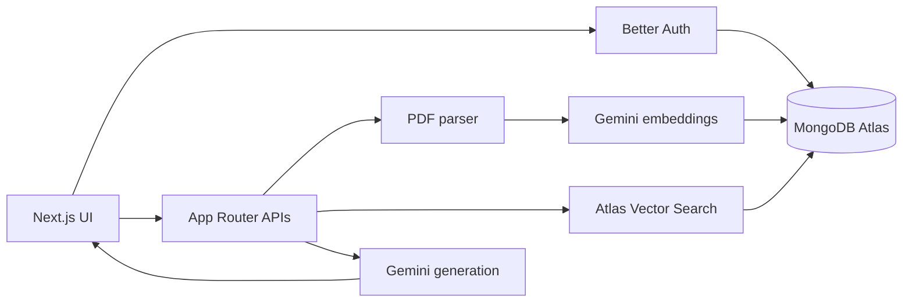

# AI-Powered Knowledge Assistant

A secure, multi-user retrieval-augmented generation application for uploading
PDF documents and asking grounded questions about their contents. Answers are
generated with Gemini and include page-level links back to the source files.

## Features

- Google OAuth authentication with database-backed sessions
- Private document and conversation workspaces for every user
- PDF validation, parsing, chunking, and Gemini embeddings
- MongoDB Atlas Vector Search with ownership filtering before ranking
- Grounded Gemini answers with document and page citations
- Persistent, searchable, renameable conversation history
- Citation-aware document deletion that preserves valid multi-document sources
- Responsive dashboard, document manager, chat, and account settings
- Route-level regression tests for authentication, ownership, and deletion

## Architecture



The application uses Next.js Server Components for authenticated page loads and
Route Handlers for uploads, chat, document management, and conversation
management. Mongoose owns domain data, while Better Auth uses the native MongoDB
client for users and sessions.

## Technology

- Next.js 16 and React 19
- TypeScript and Tailwind CSS 4
- Better Auth with Google OAuth
- MongoDB Atlas, Mongoose, and Atlas Vector Search
- Google Gemini generation and embeddings
- Vitest

## Prerequisites

- Node.js 20 or newer
- A MongoDB Atlas cluster
- A Google Cloud OAuth client
- A Google Gemini API key

## Local Setup

1. Install dependencies:

   ```bash
   npm install
   ```

2. Create the local environment file:

   ```powershell
   Copy-Item .env.example .env.local
   ```

3. Generate a Better Auth secret:

   ```bash
   node -e "console.log(require('crypto').randomBytes(32).toString('base64url'))"
   ```

4. Fill in `.env.local` with your MongoDB, Google OAuth, Gemini, and auth
   configuration.

5. Create the Atlas Vector Search index described below.

6. Start the development server:

   ```bash
   npm run dev
   ```

7. Open [http://localhost:3000](http://localhost:3000).

## Environment Variables

| Variable                 | Required | Purpose                                                 |
| ------------------------ | -------- | ------------------------------------------------------- |
| `MONGODB_URI`            | Yes      | Atlas connection string, including the database name    |
| `BETTER_AUTH_SECRET`     | Yes      | Secret used to protect authentication state             |
| `BETTER_AUTH_URL`        | Yes      | Public application origin, without a trailing slash     |
| `GOOGLE_CLIENT_ID`       | Yes      | Google OAuth client ID                                  |
| `GOOGLE_CLIENT_SECRET`   | Yes      | Google OAuth client secret                              |
| `GEMINI_API_KEY`         | Yes      | Gemini API key                                          |
| `GEMINI_EMBEDDING_MODEL` | No       | Defaults to `gemini-embedding-001`                      |
| `GEMINI_MODEL`           | No       | Primary generation model                                |
| `GEMINI_FALLBACK_MODEL`  | No       | Fallback generation model                               |
| `MIN_RETRIEVAL_SCORE`    | No       | Similarity threshold from `0` to `1`; defaults to `0.7` |

Never commit `.env.local` or production credentials.

## Google OAuth

For local development, configure the Google OAuth client with:

- Authorized JavaScript origin: `http://localhost:3000`
- Authorized redirect URI:
  `http://localhost:3000/api/auth/callback/google`

Add equivalent entries for the production domain before deployment.

## Atlas Vector Search

Create an Atlas Vector Search index with these settings:

- Database: the database named in `MONGODB_URI`
- Collection: `documentchunks`
- Index name: `document_embedding_index`

```json
{
  "fields": [
    {
      "type": "vector",
      "path": "embedding",
      "numDimensions": 768,
      "similarity": "cosine"
    },
    {
      "type": "filter",
      "path": "ownerId"
    }
  ]
}
```

The `ownerId` filter is part of the vector query, so another user's chunks are
excluded before similarity ranking occurs.

## Security Model

- The Next.js proxy performs optimistic page redirects only.
- Every protected page and API validates the server-side session.
- Domain queries include the authenticated `ownerId`.
- Child messages are accessed only after their parent conversation is owned.
- Cross-user resource identifiers return `404` instead of revealing existence.
- Vector retrieval filters by `ownerId` before ranking and verifies document
  ownership through an aggregation lookup.
- Uploads are restricted to PDFs under 4 MB and validated by MIME type and file
  signature.
- Deleting a document removes its chunks and stored citations while preserving
  sources from other documents.

## Testing

Run the automated route regression suite:

```bash
npm test
```

Run tests in watch mode:

```bash
npm run test:watch
```

Run the complete local validation pipeline:

```bash
npm test
npm run lint
npm run build
```

The current tests cover unauthenticated access, invalid identifiers, cross-user
resource isolation, missing-source filtering, mixed-source citation cleanup,
and source-empty conversation deletion.

## Deployment to Vercel

1. Push the repository to GitHub and import it into Vercel.
2. If the repository contains this project as a subdirectory, set the Vercel
   Root Directory to `ai-knowledge-assistant`.
3. Add every required environment variable in the Vercel project settings.
4. Set `BETTER_AUTH_URL` to the final HTTPS production origin.
5. Add the production origin and Better Auth callback URL to the Google OAuth
   client.
6. Allow the deployment to reach MongoDB Atlas through the Atlas network access
   settings.
7. Confirm that `document_embedding_index` is active before uploading files.
8. Deploy, then repeat the two-account isolation test against production.

Production Google OAuth values follow this format:

```text
Origin:   https://your-domain.example
Callback: https://your-domain.example/api/auth/callback/google
```

## Project Structure

```text
app/                  Pages and API Route Handlers
components/           Chat, document, dashboard, auth, and layout UI
lib/                  Auth, database, PDF, Gemini, and retrieval logic
models/               Mongoose domain schemas
tests/api/            Route-level regression tests
types/                Shared TypeScript types
proxy.ts              Optimistic authentication redirects
```
